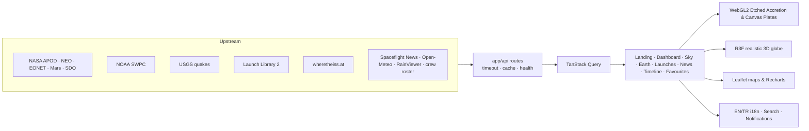

<div align="center">


<p>
  <a href="https://nebula-tau-nine.vercel.app"></a>
  
  
  
</p>

<p><em>Live space exploration, astronomy, Earth events and science news in one bilingual (EN/TR) observatory.<br>
Every feed is proxied, cached, timed out, health-checked and named when it fails.</em></p>

</div>


## One screen for the planet and the sky

Nebula opens with an interactive WebGL2 **Etched Accretion** singularity hero (`100svh`, pointer parallax and hold-to-feed interaction) and brings a dozen public science feeds into a calm, editorial observatory: a photorealistic 3D Earth with live ISS coordinates, procedural copperplate observatory plates drawn from real telemetry, what is launching next, which asteroids pass nearby, where the ground is shaking, how stormy the Sun is, and NASA's Astronomy Picture of the Day. Around the landing stage sit a streamlined 4-band mission dashboard, sky almanac, Earth monitor, launch manifest, space weather desk, newsroom, unified timeline and local favourites.

> **A dashboard that lies is worse than none.** Every reading comes from an upstream measurement rather than placeholder constants, dead feeds name their upstream source and error cause, and archival datasets (such as InSight Mars weather) label their last transmission date explicitly.


## What's on it

| | |
|---|---|
| **Etched Accretion hero & banners** | Self-contained WebGL2 black-hole engraving shader (`crimson`, `ember`, `glacier`, `ash`, `orchid` presets) powering the `100svh` landing hero and shared inner-page observatory banners, honouring `prefers-reduced-motion`. |
| **Observatory engraving plates** | Three high-DPI copperplate canvas folios driven by live telemetry — Solar Corona & IMF Flux (with live NASA SDO AIA 171Å toggle), Lithosphere Seismic Wavefronts with seismograph drum trace, and Keplerian Orbital Ephemeris — exportable as PNG prints. |
| **Realistic 3D Earth globe** | React Three Fiber globe built with self-hosted NASA Blue Marble, topology bump, and ocean specular textures, procedural drifting cloud layer, dual Rayleigh Fresnel atmosphere shaders, 51.6° orbital ring, and live ISS & USGS pins. |
| **Mission dashboard (`/dashboard`)** | Four-band layout: compact `LiveBriefing` ticker and single-row `StatsBar` ledger, AI daily briefing + quiet `WatchlistCard` alert rules, APOD/ISS/Solar/NEO grid, launches/weather/crew roster, and the 7-day earthquake log. |
| **ISS live tracker** | Measured position, altitude, velocity and eclipse state, 90-minute SGP4 ground track, and next visible pass prediction for your coordinates. |
| **Launches & countdowns** | Upcoming and past manifests across SpaceX or all agencies via Launch Library 2, live `Countdown` timers, and verified launch success statistics over named UTC ranges. |
| **Earthquake monitor & layers** | USGS M4.0+ events on a Leaflet map with magnitude charts, depth histogram, tsunami filter, NASA EONET wildfires/volcanoes/storms, and RainViewer precipitation radar. |
| **Solar activity & Mars desk** | NOAA SWPC Kp index (accurate G-scale boundaries), solar wind plasma/IMF telemetry (`no-store` uncached >2 MB feeds), SDO imagery, NASA NeoWs asteroids, and Curiosity/Perseverance/InSight rover status. |
| **Sky almanac (`/sky`)** | Moon phase and Earth rotation computed from the UTC clock, constellation and planet of the day, astronomy fact, space quote, and clearly archival Mars meteorology. |
| **Space news (`/news`)** | Filterable and pageable dispatches from Spaceflight News API v4. |
| **Bilingual EN / TR & Search** | Full English and Turkish dictionaries (`lib/i18n.tsx`) persisted across reloads, grouped `Monitor · Cosmos · Archive` navigation, and <kbd>⌘</kbd> <kbd>K</kbd> command palette searching across records and feeds. |
| **Alerts & Favourites** | Deduplicated browser notifications for quakes, geomagnetic storms, upcoming launches and APOD, plus JSON-validated export/import favourites. |


## Honest by construction

| Rule | What it prevents |
|---|---|
| Upstream fetches enforce explicit timeouts, returning `502` with source name and cause. | A stalled feed hanging a route until platform timeout, or an opaque `500`. |
| Real-time NOAA solar wind feeds (`> 2 MB`) bypass Next data cache cleanly (`cache: "no-store"`). | Silent cache write failures and stale magnetosphere readings. |
| The footer's System Telemetry matrix probes all live sources through `/api/health`. | Static fake "Operational" badges masking unreachable upstreams. |
| A failed feed is surfaced inline with retry controls and exact upstream details. | Empty states being misread as "zero events" or "no results". |
| Every sky card declares whether values are computed, curated, or archival and names its source. | Historical datasets (e.g. InSight Mars sols) masquerading as live weather. |
| Daily report synthesis waits for live feed resolution and keys strictly on measurement count and locale. | Duplicate `/api/ai-report` calls firing on initial zero-state placeholders. |
| Alerts deduplicate cleanly using stable IDs (APOD date, LL2 launch ID, storm Kp level + UTC day). | Repeat notifications when navigating or when a launch NET shifts. |


## How it fits together



| Layer | Stack |
|---|---|
| App | Next.js 16 (App Router) · React 19 · TypeScript (`Space Grotesk`, `Fraunces`, `Plus Jakarta Sans`, `JetBrains Mono`) |
| UI | Tailwind CSS v4 · Framer Motion · cmdk · lucide-react |
| Shaders & 3D | Custom WebGL2 fragment shader (`EtchedAccretion`) · React Three Fiber & drei · Three.js · high-DPI Canvas 2D |
| Data | TanStack Query v5 · Zustand · `satellite.js` · `suncalc` · `date-fns` |
| Maps & Charts | Leaflet / `react-leaflet` · Recharts |
| Tests | Playwright end-to-end and API contract specs, alongside `tsc --noEmit`, `eslint`, and production `next build` |


## Pages

| Route | Page |
|---|---|
| `/` | Etched Accretion WebGL2 hero, realistic 3D globe & copperplate observatory plates |
| `/dashboard` | Streamlined 4-band live mission control & watchlist |
| `/sky` | Sky almanac, Mars rovers & archival InSight weather |
| `/space` | ISS telemetry, asteroids, APOD & NOAA solar observatory |
| `/earth` | Earthquakes, EONET natural hazards & RainViewer precipitation radar |
| `/launches` | Upcoming and past manifests with live countdowns & agency filter |
| `/news` | Filterable spaceflight newsroom |
| `/timeline` | Unified chronological event stream with category filters |
| `/favorites` | Saved items collection with schema-checked JSON export/import |


## Türkçe özet

**Nebula**, uzay ve Dünya olaylarını tek yerde toplayan çift dilli (TR/EN) canlı bilim gözlemevidir. Tam ekran **Etched Accretion** WebGL2 kara delik açılışı, bulut katmanlı ve Fresnel atmosferli gerçekçi 3B Dünya küresi, canlı NOAA/USGS/ISS verilerinden üretilen bakır gravür gözlemevi levhaları, 4 bantlı sadeleştirilmiş görev paneli (`/dashboard`), yaklaşan roket fırlatmaları, asteroitler, depremler, orman yangınları, yağış radarı ve NASA günün astronomi fotoğrafını içerir. Tüm veriler zaman aşımlı 15 API rotasından geçer; kaynak sağlığı footer telemetri şeridinden canlı izlenir.


## Development

```sh
npm install
cp .env.example .env.local   # NASA API key (optional, DEMO_KEY works)
npm run dev                  # http://localhost:3000
npm run typecheck
npm run lint
npm run build
npm test                     # Playwright e2e + API contracts
```

`NASA_API_KEY` is optional (`DEMO_KEY` works with NASA hourly limits). `OPENAI_API_KEY` enables model-synthesised daily briefings; without it the briefing uses measured figures only. `NEXT_PUBLIC_SITE_URL` configures canonical and Open Graph metadata URLs.

```
app/            routes: landing (/), dashboard, sky, space, earth, launches, news, timeline, favorites
app/api/        fifteen API routes: upstream proxies with timeouts, caching and /api/health probes
components/     dashboard, earth, landing, news, sky and ui (incl. EtchedAccretion & EtchedBanner)
hooks/          alerts, favorites, hydration, clock, theme and watchlist hooks
lib/            upstream client, astronomy, dataviz, EN/TR dictionaries, natural events, search index
tests/          Playwright E2E and API contract specs
```

<div align="center">
<br>
<a href="https://github.com/kutluhangil"></a>
<sub>MIT licensed · data from NASA, NOAA, USGS, Launch Library 2, wheretheiss.at, Spaceflight News, Open-Meteo and RainViewer · readings in the banner are illustrative.</sub>
</div>
