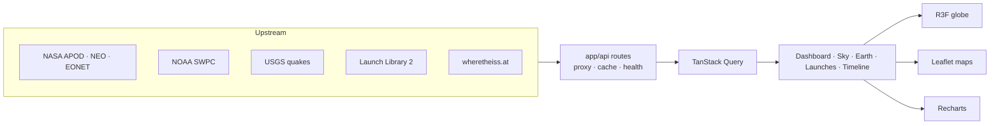

<div align="center">



<p>
  <a href="https://nebula-tau-nine.vercel.app/"></a>
  
  
  
</p>

<p><em>Live space exploration, astronomy, Earth events and science news in one immersive dashboard.<br>
Every feed is proxied, cached and health-monitored.</em></p>

</div>


## What's on the dashboard

| | |
|---|---|
| **Rotating Earth** | A WebGL globe on the hero, with textures served from the same origin. |
| **ISS live tracker** | Measured position, altitude, velocity and eclipse state, plus the next visible pass for your location. |
| **Launches** | Latest and upcoming launches with countdown timers. |
| **Earthquake monitor** | USGS M4.0+ events on an interactive Leaflet map. |
| **Earth event layers** | NASA EONET wildfires, volcanoes and severe storms. |
| **Solar activity** | NOAA SWPC Kp index, aurora probability and geomagnetic storms. |
| **Near-Earth asteroids** | NASA NEO hazardous asteroid tracking. |
| **APOD** | The Astronomy Picture of the Day, with a fullscreen mode. |
| **Daily report** | A generated planet-intelligence briefing. |
| **Sky and timeline** | Tonight's sky for your location and every event in one chronological timeline. |


## How it fits together



| Layer | Stack |
|---|---|
| App | Next.js 16 (App Router, ISR) · React 19 · TypeScript |
| UI | Tailwind CSS · Framer Motion · cmdk · lucide |
| Data | TanStack Query · zustand · satellite.js · suncalc |
| Visuals | React Three Fiber · Leaflet · Recharts |
| Tests | Playwright end-to-end and API contract specs |


## Türkçe özet

**Nebula**, uzay ve Dünya olaylarını tek ekranda toplayan canlı bir bilim paneli. ISS'in anlık konumu, yaklaşan roket fırlatmaları, Dünya'ya yakın asteroitler, depremler, orman yangınları, Güneş etkinliği ve NASA'nın günün astronomi fotoğrafı aynı yerde. Tüm veriler Next.js API rotalarından geçip önbellekleniyor; her kaynağın sağlığı izleniyor.


## Development

```sh
npm install
cp .env.example .env.local   # NASA API key (optional, DEMO_KEY works)
npm run dev                  # http://localhost:3000
npm run typecheck
npm test                     # Playwright
npm run build
```

```
app/            routes: dashboard, sky, space, earth, launches, news, timeline, favorites
app/api/        upstream proxies with caching and health checks
components/     dashboard, sky, earth, news and ui building blocks
lib/            upstream client, sky data, search index
tests/          e2e and API contract specs
```

<div align="center">
<br>
<a href="https://github.com/kutluhangil"></a>
<sub>Data from NASA, NOAA, USGS, Launch Library 2 and wheretheiss.at.</sub>
</div>
