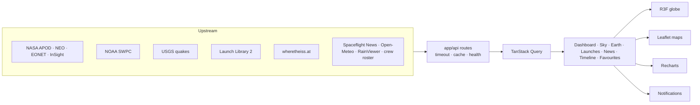

<div align="center">


<p>
  <a href="https://nebula-tau-nine.vercel.app"></a>
  
  
  
</p>

<p><em>Live space exploration, astronomy, Earth events and science news in one immersive dashboard.<br>
Every feed is proxied, cached, timed out, health-checked and named when it fails.</em></p>

</div>


## One screen for the planet and the sky

Nebula pulls a dozen public sources into a single dashboard: where the ISS is right now and when it next passes over you, what is launching, which asteroids are close, where the ground is shaking, what is burning, how stormy the Sun is, and what NASA photographed today. Around it sit pages for tonight's sky, the Earth monitor, launches, space news, a chronological timeline and your own favourites.

> **A dashboard that lies is worse than none.** An audit removed every fabricated constant: a hard-coded "27,600 km/h" ISS speed, a report that invented the station's altitude, Kp labels shifted one step against the NOAA G scale, and a dead feed that put the ISS in the Gulf of Guinea at 0°, 0°. Every number now comes from a measurement, and every failure names its source and cause.


## What's on it

| | |
|---|---|
| **Rotating Earth** | A WebGL globe on the hero, with textures served from the same origin, and the most recent recorded event linking to the Earth monitor. |
| **ISS live tracker** | Measured position, altitude, velocity and eclipse state, plus the next visible pass for your location. |
| **Stat bar** | M4.0+ count and mean magnitude over seven days, measured ISS altitude, hazardous asteroids, current Kp and active solar storms (G-scale alerts in the last 24 hours). |
| **Launches** | Latest and upcoming launches with countdowns, and a success record reported as "N of M" over a named UTC range. |
| **Earthquake monitor** | USGS M4.0+ events on a Leaflet map, with a magnitude and tsunami filter. |
| **Earth layers** | NASA EONET wildfires, volcanoes and severe storms, plus RainViewer precipitation radar. |
| **Solar activity** | NOAA SWPC Kp index, aurora probability and geomagnetic storms. |
| **Near-Earth asteroids** | NASA NEO hazardous asteroid tracking. |
| **APOD** | The Astronomy Picture of the Day, with a fullscreen mode. |
| **Sky almanac** | Moon phase and Earth's rotation computed from the clock, constellation and planet of the day, an astronomy fact, a quote, and Mars weather (clearly marked archival). |
| **Space news** | Headlines from the Spaceflight News API. |
| **People in space** | The current crew roster. |
| **Universal search** | <kbd>⌘</kbd> <kbd>K</kbd> searches records, not just pages: missions, rockets, planets, astronauts, today's NEOs and recent quakes. |
| **Alerts** | Browser notifications for a big quake, a geomagnetic storm, a launch an hour before liftoff and a new APOD, each with its own toggle and rule. |
| **Favourites** | Save anything, then export and import the collection as a file. |
| **Daily report** | An optional generated briefing built only from the measured numbers on the page. |


## Honest by construction

| Rule | What it prevents |
|---|---|
| Every upstream fetch has a 10 s timeout, and routes return 502 with the source and cause. | A stalled source holding a route open until the platform timeout, or a generic 500 nobody can act on. |
| The footer's System Status list is a live probe of every source through `/api/health`. | It used to render "Operational" as static markup whether or not anything was reachable. |
| A failed feed is named above search results with its upstream message. | An empty result over a dead feed being read as "no such record". |
| Every sky card declares whether its numbers are computed, curated or archival, and names the publication. | Curated facts passing as live data; InSight's Mars weather has not updated since 2020 and says so. |
| "Of the day" records are picked by whole UTC days since the epoch, not at random. | Server and client disagreeing (hydration mismatch) and "today's" record changing on reload. |
| Alerts are deduplicated per source with stable ids (APOD by date, launches by Launch Library id, storms by Kp level and UTC day). | Re-alerting after navigation, or alerting twice when a launch's NET moves. |
| Search matches by prefix, then substring, then every word, instead of fuzzy subsequence. | "M6" matching an astronaut's name and "Falcon" matching Mexican earthquakes. |


## How it fits together



| Layer | Stack |
|---|---|
| App | Next.js 16 (App Router, ISR) · React 19 · TypeScript |
| UI | Tailwind CSS · Framer Motion · cmdk · lucide |
| Data | TanStack Query · zustand · satellite.js · suncalc · date-fns |
| Visuals | React Three Fiber · Leaflet · Recharts |
| Tests | Playwright end-to-end and API contract specs, run in CI with lint, typecheck, build and a production dependency audit |


## Pages

| Route | Page |
|---|---|
| `/` · `/dashboard` | Landing and the live dashboard |
| `/sky` | The sky almanac |
| `/space` | ISS, asteroids, APOD and solar activity |
| `/earth` | Earthquakes, natural events and radar on the map |
| `/launches` | Upcoming and past launches with the success record |
| `/news` | Space news |
| `/timeline` | Every event in one chronological line |
| `/favorites` | Saved items, export and import |


## Türkçe özet

**Nebula**, uzay ve Dünya olaylarını tek ekranda toplayan canlı bir bilim paneli. ISS'in anlık konumu ve senin konumundan bir sonraki geçişi, yaklaşan roket fırlatmaları, Dünya'ya yakın asteroitler, depremler, orman yangınları, yağış radarı, Güneş etkinliği ve NASA'nın günün astronomi fotoğrafı aynı yerde. ⌘K ile kayıtlar arasında arama, deprem ve fırtına bildirimleri, dışa aktarılabilir favoriler var. Tüm veriler zaman aşımlı ve önbellekli API rotalarından geçiyor; her kaynağın sağlığı canlı izleniyor ve hiçbir sayı uydurma değil.


## Development

```sh
npm install
cp .env.example .env.local   # NASA API key (optional, DEMO_KEY works)
npm run dev                  # http://localhost:3000
npm run typecheck
npm test                     # Playwright e2e + API contracts
npm run build
```

`NASA_API_KEY` is optional. `OPENAI_API_KEY` turns on the daily report; without it the report is assembled from the measured numbers only. `NEXT_PUBLIC_SITE_URL` sets canonical URLs.

```
app/            routes: dashboard, sky, space, earth, launches, news, timeline, favorites
app/api/        fifteen API routes: upstream proxies with timeouts, caching and health checks
components/     dashboard, sky, earth, news and ui building blocks
hooks/          alerts and data hooks
lib/            upstream client, astronomy, natural events, search index, favourites file
tests/          e2e and API contract specs
```

<div align="center">
<br>
<a href="https://github.com/kutluhangil"></a>
<sub>MIT licensed · data from NASA, NOAA, USGS, Launch Library 2, wheretheiss.at, Spaceflight News, Open-Meteo and RainViewer · readings in the banner are illustrative.</sub>
</div>
